Documents
=========

Reads office documents on LuneOS: Word (.docx), OpenDocument (.odt,
.ods, .odp), Excel (.xlsx, .xls), PowerPoint (.pptx), CSV, plain text
and Markdown. A web app in Enyo 1, like the LuneOS core apps, for the
tablet (1024×768), tall phones (480×800) and the square Q25 (720×720).

It is a viewer first: documents are shown, searched and zoomed, and
workbooks can have a few cells changed and be saved as a new copy.

On a device
-----------

Taken by `tools/test-device.sh` (the library, a text document, a Word
document, a workbook, a presentation, find, and a 50 000-row workbook
being read).

**mindphone** (480×800):

<table>
  <tr>
    <td align="center">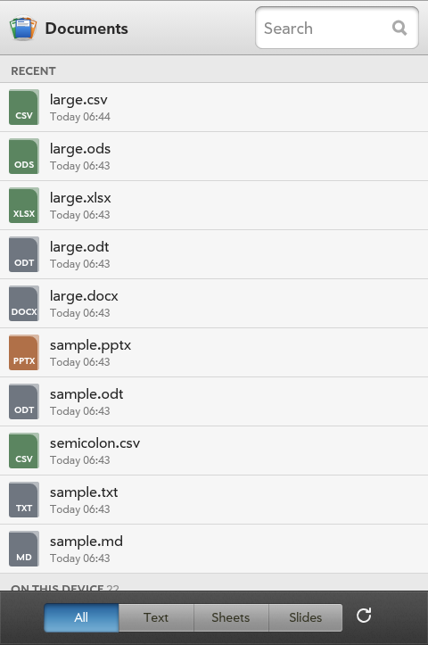</td>
    <td align="center">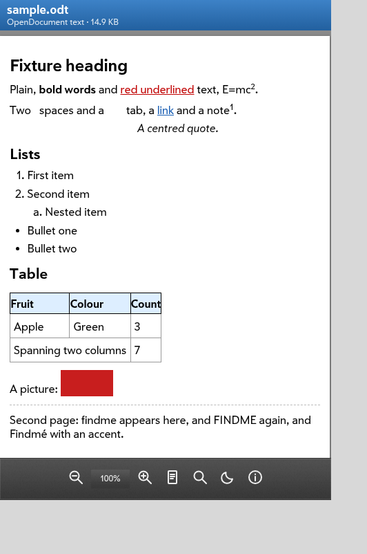</td>
    <td align="center">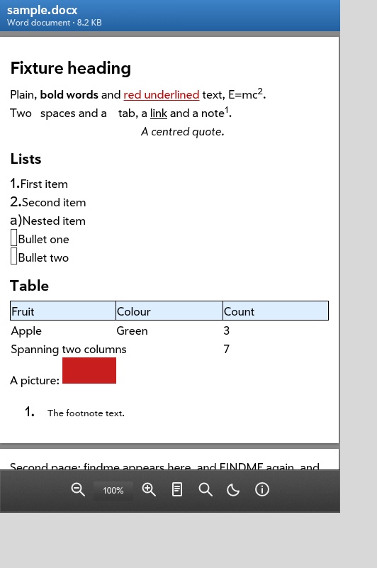</td>
    <td align="center">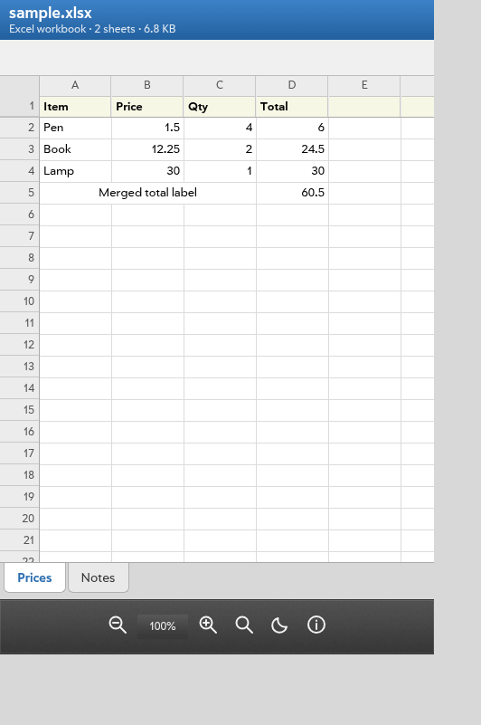</td>
    <td align="center">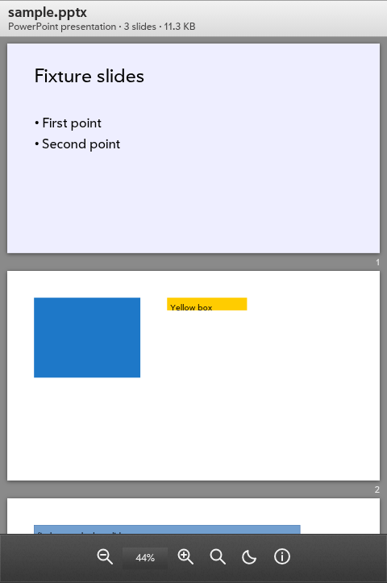</td>
    <td align="center">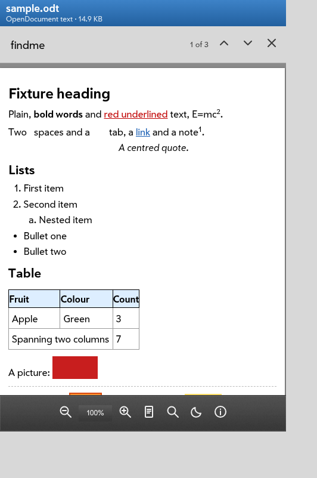</td>
  </tr>
  <tr>
    <td align="center">Library</td>
    <td align="center">.odt, reflowed</td>
    <td align="center">.docx</td>
    <td align="center">.xlsx</td>
    <td align="center">.pptx</td>
    <td align="center">Find</td>
  </tr>
</table>

**Q25** (720×720):

<table>
  <tr>
    <td align="center">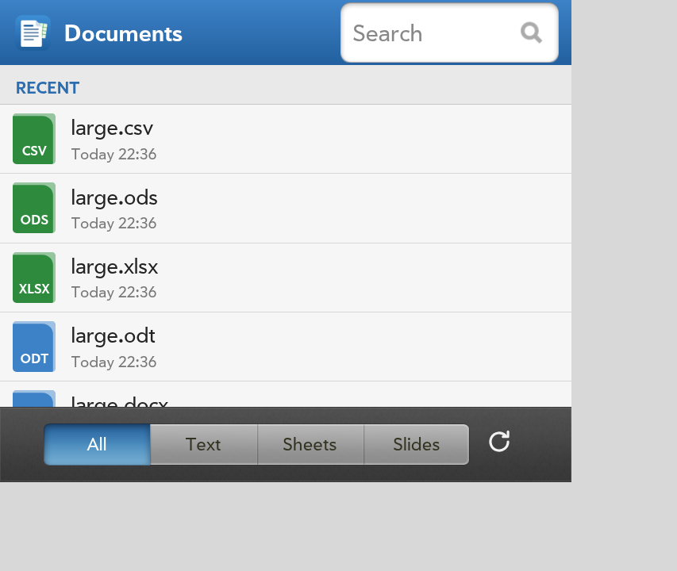</td>
    <td align="center">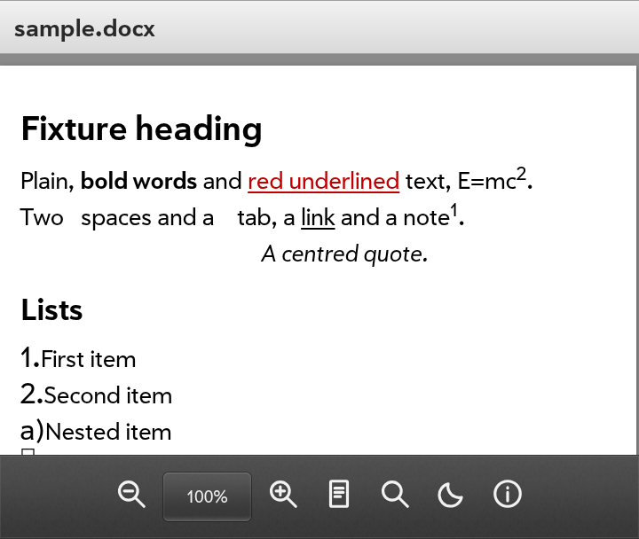</td>
    <td align="center">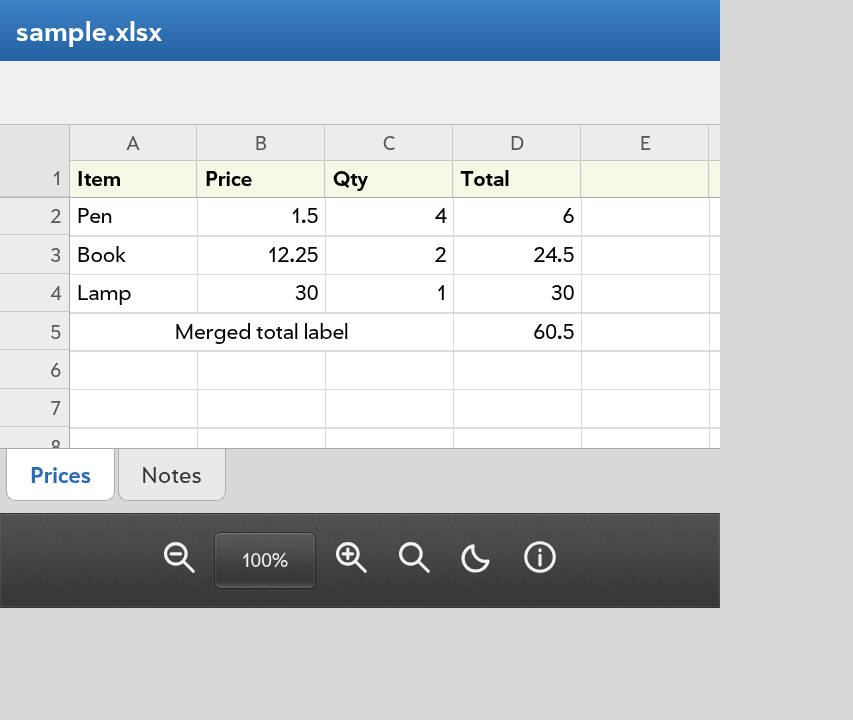</td>
    <td align="center">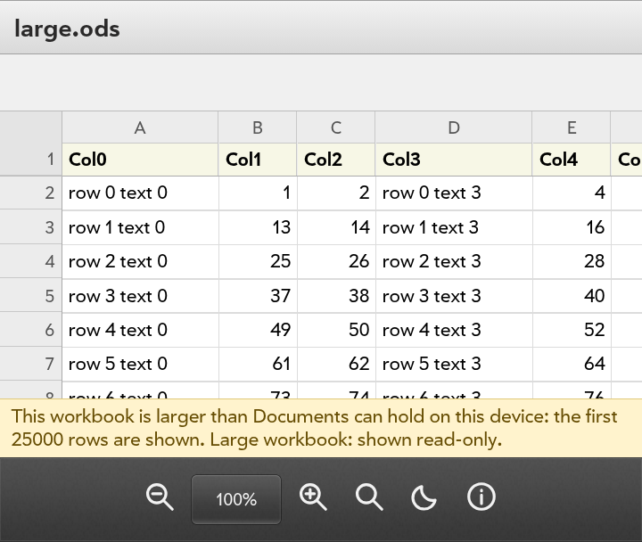</td>
  </tr>
  <tr>
    <td align="center">Library</td>
    <td align="center">.docx</td>
    <td align="center">.xlsx</td>
    <td align="center">50 000 rows, .ods</td>
  </tr>
</table>

**HP TouchPad** (1024×768):

<table>
  <tr>
    <td align="center">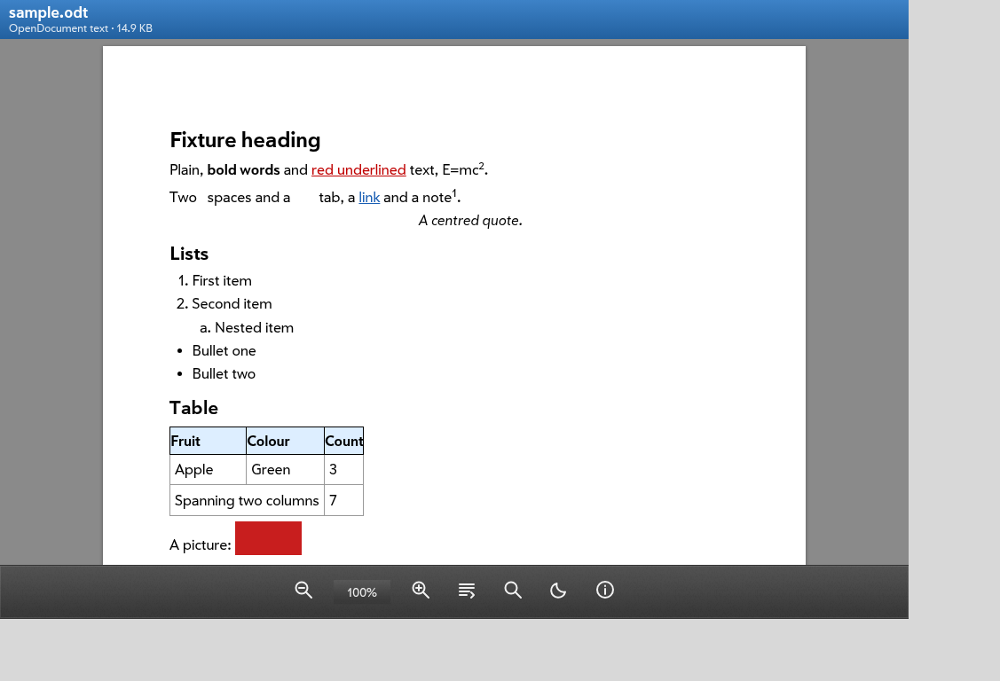</td>
    <td align="center">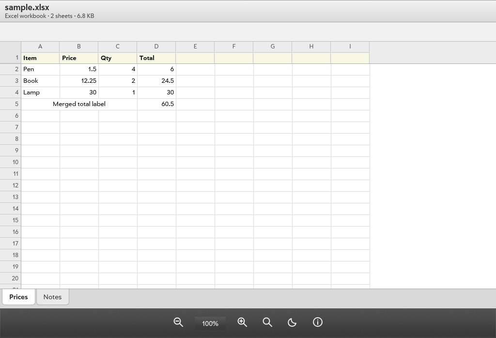</td>
    <td align="center">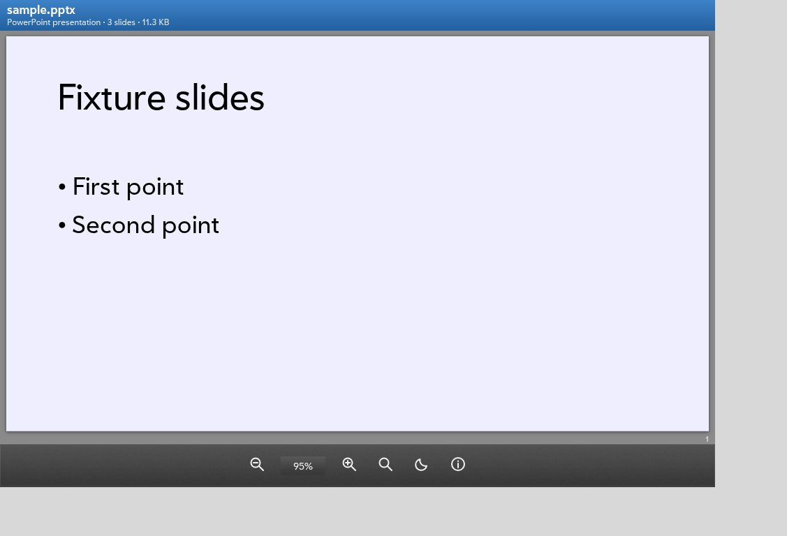</td>
  </tr>
  <tr>
    <td align="center">.odt, as pages</td>
    <td align="center">.xlsx</td>
    <td align="center">.pptx</td>
  </tr>
</table>

Features
--------

### Finding a document

- **Library:** every document under `/media/internal` (the USB
  storage), the recently opened ones first. Filter by Text, Sheets or
  Slides; search by name. Hidden folders are not walked.
- The folders are listed through the File Manager's service
  (`org.webosports.service.filemanager`), the one directory listing a
  web app has. It joins names with commas, so a name that has a comma
  is put back together and checked before it is listed.
- **Opened from other apps:** appinfo.json's `mimeTypes` registers the
  app for every kind it reads; `{"target": "file:///media/internal/..."}`
  (or a plain path) opens that document, also in an app already open.

### Reading

- **Text documents** as pages on a tablet, reflowed to the screen on a
  phone (the key in the toolbar switches).
- **Presentations** as slides one under the other, fitted to the width.
- **Workbooks** in a grid with column letters and row numbers that stay
  in place, the first row frozen under the letters (app menu: Unfreeze
  First Row), sheet tabs, merged cells, numbers to the right. Tap a cell
  to see its value or formula.
- **Zoom:** the toolbar's keys, the percentage to go back to fit,
  Ctrl + wheel, or a pinch.
- **Find:** every match marked, the current one stronger, "3 of 17",
  the one before and after; case and accents are ignored. In a workbook
  it goes to the cell.
- **Night reading:** pages light on dark, pictures in their own colours;
  kept for the next start.
- **Document info:** file, folder, type, size, and the title, author
  and dates the document records.
- **Links:** a tap asks first, then opens the browser. Links inside the
  document go to their place.
- The back gesture closes what is open first (a dialog, find, editing a
  cell), then goes back to the library.

### Editing a workbook

- Tap a cell, **Edit** (or tap it again), type a value, a number or a
  formula, **Done** or Enter.
- **Save a Copy** writes a new file next to the original ("Budget
  (edited).xlsx"); the original is never changed and an existing file
  is never replaced. .xlsx and .xls are saved as .xlsx, .ods as .ods,
  .csv as .csv. The copy keeps values and formulas, not formatting,
  charts or pictures, and the dialog says so.
- Saving needs the app's small service (see Building), which creates
  the file with O_EXCL. Without it, Edit is not offered.
- Large workbooks (below) are read-only.

What is shown, and how
----------------------

| Kind | Read by | Kept | Not kept |
|---|---|---|---|
| .docx | docx-preview; documents with more than 250 KB of text XML by Docx.js | docx-preview: close to the original layout. Docx.js: styles, headings, list labels, tables with spans, pictures, links, footnotes | Docx.js: headers and footers, positioned text boxes, columns |
| .odt, .fodt | Odf.js | paragraph and text styles, headings, lists, tables with spans and shading, pictures, links, footnotes, page breaks | positioned frames, headers and footers, columns, pictures inside a flat .fodt |
| .xlsx, .ods, .xls, .fods | SheetJS; .xlsx and .ods with more than 4 MB of sheet XML by SheetStream.js | values as formatted, formulas, merged cells, column widths, row heights, hidden sheets | cell styles (fonts, colours, borders), charts, pictures, conditional formatting |
| .csv, .tsv | Text.js | the delimiter (comma, semicolon, tab, bar) is found by itself | |
| .pptx | Pptx.js | text boxes and placeholders with the master's sizes, colours and bullets, pictures, filled rectangles and ellipses, tables, groups, the layout's and master's decoration | charts and SmartArt (a box says so), gradients (first colour), effects, custom shapes' outlines |
| .odp | Odf.js | text frames with the presentation styles, pictures, filled shapes | master page decoration |
| .md | Text.js | headings, emphasis, code, lists, tables, quotes, links | raw HTML is shown as text |
| .txt | Text.js | UTF-8, UTF-16 with a byte order mark, else Windows-1252 | |

The binary .doc and .ppt (from before 2007), .rtf and PDF are
recognised and named, not opened.

Nothing in a document reaches the page as markup or script: the
readers build plain data, the page builds it with createElement and
text nodes, styles are whitelisted, docx-preview's links lose their
href, and Markdown escapes all of its input.

Large documents
---------------

Documents are unzipped and parsed in a Web Worker, so the page stays
usable while that runs.

- **Text** is rendered a slice at a time, each slice laid out only
  when near the screen (content-visibility: auto).
- **Large .xlsx and .ods** are streamed: the XML is inflated and parsed
  a chunk at a time and only each cell's text is kept, at most 300 000
  cells; the grid shows the first rows at once and gets the rest in
  batches. This keeps a workbook whose XML is tens of megabytes from
  ever being one string, or a whole workbook object, in memory. Before
  this, opening a 600 000-cell workbook crashed the HP TouchPad's
  shared web process (WAM logged WEBPROC_CRASH), and every open web app
  with it.
- **Long CSV** files reach the grid in batches the same way; .xls files
  larger than 3 MB are read up to 20 000 rows per sheet.
- The grid builds only the cells near the screen.

Measured with `tools/test-device.sh` on 2026-10-16 (time until the
document is shown / until all of it is read; "longest wait" is the
longest the page did not answer, polled every 250 ms):

| Document | HP TouchPad (2 cores) | mindphone (4 cores) | Q25 (8 cores) |
|---|---|---|---|
| large.docx, 3 000 paragraphs, 2 MB XML | 4.0 s / 7.8 s, 1.2 s | 1.6 s / 3.0 s, 0.8 s | 0.4 s / 0.7 s, 0.6 s |
| large.odt, same text | 2.3 s / 6.0 s, 1.2 s | 0.8 s / 2.5 s, 1.0 s | 0.2 s / 0.6 s, 0.5 s |
| large.xlsx, 50 001×12, 3 MB (42 MB of XML) | 12.4 s / 23.7 s, 2.5 s | 7.0 s / 13.1 s, 0.4 s | 1.5 s / 2.6 s, 0.3 s |
| large.ods, same cells, 3.5 MB (82 MB of XML) | 1.4 s / 23.4 s, 1.4 s | 0.3 s / 12.2 s, 0.4 s | 0.1 s / 2.2 s, 0.3 s |
| large.csv, same cells, 6 MB | 2.2 s / 4.9 s, 1.7 s | 0.5 s / 1.2 s, 0.4 s | 0.1 s / 0.3 s, 0.3 s |

The three workbooks hold 600 000 cells; the first 300 000 (25 000 rows)
are shown, and the app says so. No WAM renderer crash on any of the
devices during these runs.

Building
--------

    tools/build-ipk.sh                    build/org.webosports.app.documents_<version>_all.ipk
    WITH_SERVICE=1 tools/build-ipk.sh     ... with the service that saves copies

The service (`services/org.webosports.app.documents.service/`, a few
lines of node on palmbus) is left out by default. appinstalld asks a
package's JS services to quit before it updates or removes the package,
and on the images tested (TouchPad, mindphone, Q25, 2026-10-16) its
client permissions lack `applicationinstall.interface`, so that call is
refused and such a package can be installed once but neither updated
nor removed. appinstalld2 2e06f07 asks for the group again; once images
carry it, the service can be in every build. A system install by a
recipe does not go through appinstalld and can include it.

Install on a device (appInstallService, opkg with its own root, so
system packages are not touched):

    adb push build/org.webosports.app.documents_0.1.0_all.ipk /tmp/
    adb shell "luna-send -w 90000 -i luna://com.webos.appInstallService/install \
        '{\"id\":\"org.webosports.app.documents\",\"ipkUrl\":\"/tmp/org.webosports.app.documents_0.1.0_all.ipk\",\"subscribe\":true}'"

or `tools/test-device.sh <adb serial> <name>`, which also runs the
device tests.

The app needs `trustLevel: "trusted"` (appinfo.json): WAM lets only
trusted apps read files outside their own folder.

The icon is `images/icon.svg`; `node tools/render-icon.js` renders
`icon.png` and `icon-256x256.png` from it. It is one of three designs in
the legacy app icon style, all drawn by `tools/icon/make-variants.py`
into `tools/icon/variants/` (fanned papers, pocket folders, a page with
index tabs); the folders were chosen. The SVGs use no filters, so Qt's
renderer, which the launcher uses, draws them as a browser does.

Code
----

- `source/core/` - no DOM, runs in the worker and in node:
  `Xml.js` (a small XML parser), `FileTypes.js`, `Odf.js`, `Docx.js`,
  `Pptx.js`, `Text.js` (decoding, Markdown, CSV), `Sheets.js`,
  `SheetStream.js`, `Engine.js` (opens a document), `Worker.js`,
  `Library.js` (the scan, launch targets, names).
- `source/views/` - `DocRender.js` (model to DOM), `Finder.js`,
  `SheetGrid.js`, `SheetView.js`, `ViewerView.js`, `LibraryView.js`.
- `source/services/` - `DocLoader.js` (file reads, the worker),
  `FileService.js` (luna).
- `lib/` - third-party, as bundled:

| Library | Version | Licence | Used for |
|---|---|---|---|
| docx-preview | 0.4.1 | Apache-2.0 | laying out .docx |
| SheetJS Community Edition | 0.20.3 | Apache-2.0 | reading and writing workbooks |
| JSZip | 3.10.2 | MIT (dual MIT/GPLv3; used under MIT); includes pako, MIT | zip containers |

Tests
-----

    tools/run-tests.sh                 syntax/ES5 check, unit tests, mocked end-to-end tests
    tools/run-tests.sh --screenshots   ... and a screenshot per end-to-end test in test-output/shots/
    python3 -I tools/tests/make-fixtures.py [--large]
    tools/test-device.sh <serial> <name> [--no-build] [--no-large]

- `tools/tests/unit-tests.js`: the readers against fixture documents,
  the helpers, the streaming parsers fed a few characters at a time,
  and the service's writer (it never replaces a file, refuses paths
  outside /media/internal). Node only.
- `tools/tests/e2e-tests.js`: the app in headless Chromium with the
  webOS runtime, the luna bus (with the device's permission groups) and
  the files mocked: the library, launch and relaunch targets, every
  format, find, zoom, night reading, links, the grid with 20 000 rows,
  editing and saving a copy, and the three screen sizes. Every test
  also fails on a page error or an unmocked or refused call.
- `tools/tests/device-tests.js`: on a device, through WAM's DevTools
  port: every fixture, the large documents, find, layout, and opening as
  Files does.
- The fixtures in `tools/tests/fixtures/` are made by `make-fixtures.py`
  from flat OpenDocument sources (in `fixtures/src/`) with LibreOffice.
- The test framework (`tools/tests/lib/`, `mock/`) comes from
  org.webosports.app.weather; the mock here also answers luna calls by
  their parameters, maps file: URLs onto the test server and provides
  WAM's palmGetResource.

License
-------

GNU General Public License version 3, see LICENSE. The libraries in lib/
keep their own licences (NOTICE, and the LICENSE file next to each).
